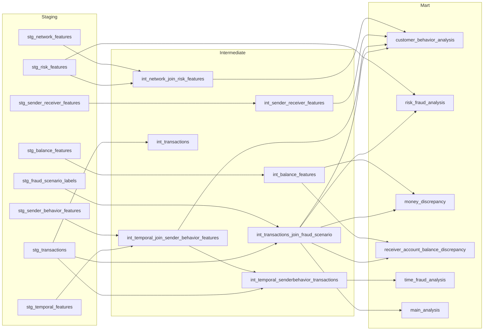

# 💳 Money Fraud: Fraud Detection in Mobile Money Transactions

🇹🇷 [Türkçe](README.md)

An end-to-end data project that analyzes fraud behavior in **6.36 million** mobile money transactions, builds a rule-based risk score, and predicts fraud with LightGBM. The data model is built layer by layer with BigQuery and dbt.

> DATA426 – Group 3 course project. This is a three-person team project: the dbt pipeline is shared, while hypothesis tests and models are individual (see [Team and Contributions](#-team-and-contributions)). The notebook in this repository is the work of team member Ceren Kocabaş.

## 🔗 Links

| | |
|---|---|
| 📊 Dashboard (Looker Studio) | [Mobile Money Fraud Analysis](https://datastudio.google.com/reporting/bdade0b5-2c91-442a-9d5c-ce3a7aa240cb/page/uoH2F) |
| 🗄️ BigQuery workspace | [data426-group3 / money_fraud](https://console.cloud.google.com/bigquery?ws=!1m4!1m3!3m2!1sdata426-group3!2smoney_fraud) (access permission required) |
| 📓 Notebook | [`Money_Fraud.ipynb`](Money_Fraud.ipynb) (can be opened in Google Colab; written in Turkish) |

---

## 📌 Project Overview

1. **Data engineering (dbt):** 8 raw BigQuery tables were cleaned, joined, and turned into analysis tables through `staging → intermediate → mart` layers.
2. **Statistical analysis:** The distribution of fraud across transaction types and account-draining behavior were examined with hypothesis tests.
3. **Risk scoring:** A transaction-level rule-based risk score and risk segments were defined, and their real performance was measured.
4. **Machine learning:** The first setup (Experiment 1) produced too many false alarms. A corrected setup (Experiment 2) was compared against a simple rule baseline.
5. **Visualization:** Results were presented in a Looker Studio dashboard.

## 🛠️ Tech Stack

| Area | Tool |
|---|---|
| Data warehouse | Google BigQuery |
| Data transformation | dbt Cloud (Jinja + SQL) |
| Analysis environment | Google Colab, Python |
| Libraries | pandas, NumPy, SciPy, statsmodels, scikit-learn, LightGBM |
| Visualization | Looker Studio |

## 📊 Dataset

The data is **synthetic** mobile money transactions generated by the **PaySim** simulator (Kaggle: `ealaxi/paysim1`, a 1/4-scale version of the original dataset). The original Kaggle page is currently not accessible. Reference to cite: *PaySim: A financial mobile money simulator for fraud detection* (E. A. Lopez-Rojas et al.).

- **Total transactions:** 6,362,620
- **Fraudulent transactions:** 8,213 (~0.13%, highly imbalanced)
- **Transaction types:** `CASH_IN`, `CASH_OUT`, `DEBIT`, `PAYMENT`, `TRANSFER`
- **Target variable:** `is_fraud`

⚠️ **Important note:** The dataset authors recommend not using the balance columns (`oldbalanceOrg`, `newbalanceOrig`, `oldbalanceDest`, `newbalanceDest`) for fraud detection, because transactions detected as fraud are cancelled. The strongest features in this project (`is_liquidation`, `transfer_drain_ratio`) are derived from these columns. In addition, the simulator generates fraud through an account-draining scenario. Therefore the results do not transfer directly to real banking data.

## 🗂️ Project Structure

```
money_fraud/
├── models/
│   ├── staging/         # One stg_ model per raw table (type casting, cleaning)
│   ├── intermediate/    # int_ models: joins between tables
│   └── mart/            # Final tables for analysis and modeling
├── analyses/
├── macros/
├── seeds/
├── snapshots/
├── tests/
├── dbt_project.yml
├── Money_Fraud.ipynb    # Hypothesis tests, risk score and machine learning
└── README.md
```

## 🔄 Data Flow (dbt Lineage)



### Staging layer

| Model | What it does |
|---|---|
| `stg_..__transactions` | Renames columns, rounds monetary fields to 2 decimals, casts flags to `integer` |
| `stg_..__fraud_scenario_labels` | Lowercases scenario labels, fills missing values with `unknown` / `0` |
| `stg_..__temporal_features` | Validates `day` (1–31) and `hour` (0–23) ranges, normalizes the period of day |
| `stg_..__sender_behavior_features` | Sets negative values in sender behavior counters to 0 |
| `stg_..__sender_receiver_features` | Casts counters to `int64` and `is_new_receiver_for_sender` to `boolean` |
| `stg_..__risk_features` | Selects the rule-based risk flags |
| `stg_..__network_features` | Selects network features (degree, receiver volume) |
| `stg_..__balance_features` | Prepares balance difference and error fields (including `leakage_warning`) |

### Intermediate layer

| Model | What it does |
|---|---|
| `int_..__transactions_join_fraud_scenario` | Joins transactions with fraud scenario labels |
| `int_..__temporal_join_sender_behavior_features` | Joins temporal features with sender behavior features |
| `int_..__sender_receiver_features` | Sender–receiver relationship features |
| `int_..__network_join_risk_features` | Joins network features with risk flags |
| `int_..__balance_features` | Balance discrepancy features |
| `int_..__temporal_senderbehavior_transactions` | Enriches transactions with temporal and sender behavior features |
| `int_..__transactions` | Selects the relevant columns from the staging transaction table |

### Mart layer

Each team member built their own mart tables. In the file names, `group3` is followed by either one or two underscores, so the names are written below exactly as they are.

| Model | Purpose |
|---|---|
| `mart_data426_group3_customer_behavior_analysis` | **The main table used by this notebook.** All features, the risk score, and the segment are produced here (38 columns) |
| `mart_data426_group3_risk_fraud_analysis` | Compares the rule-based risk score/level with the real fraud label |
| `mart_data426_group3_money_discrepancy` | Balance discrepancies on the sender and receiver side |
| `mart_data426_group3__receiver_account_balance_discrepancy` | Transactions where the customer receiver's balance does not match the expected amount |
| `mart_data426_group3__time_fraud_analysis` | Transaction count, fraud rate, average/maximum amount, and spike count by hour and period of day |
| `mart_data426_group3__main_analysis` | Compact transaction-level table: `type_code`, `amount_bucket`, scenario codes (`scenario_group_code`, `fraud_scenario_code`) |

### Features produced in the main mart table

| Feature | Description |
|---|---|
| `type_code` | Numeric code of the transaction type (TRANSFER=1, CASH_OUT=2, CASH_IN=3, DEBIT=4, PAYMENT=5) |
| `amount_bucket` | Amount range (0, 0-100, 100-1K … 1M+) |
| `custom_month_id` | Month identifier for each 30-day period |
| `monthly_transfer_volume` | Sender's total monthly TRANSFER volume |
| `amount_to_monthly_volume_ratio` | Ratio of the transaction amount to the monthly transfer volume |
| `is_liquidation` | Whether the whole account balance was withdrawn (`amount = old_balance_orig > 0`) |
| `transfer_drain_ratio` | Ratio of the transaction amount to the account balance |
| `is_new_receiver_for_sender` | Sender transfers to this receiver for the first time |
| `is_night` | Night-time transaction |
| `high_amount_flag`, `high_velocity_flag`, `new_receiver_flag`, `many_to_one_receiver_flag`, `suspicious_cashout_flag` | Risk flags |
| `calculated_risk_score`, `risk_segment` | Total risk score and segment |

## 🔬 Hypothesis Tests

### 1. Transaction type vs. fraud (Chi-Square Test of Independence)

- χ² = **22,082.54**, degrees of freedom = 4, p ≈ 0 → the hypothesis that fraud is independent of transaction type was rejected.
- All fraud cases fall into two types: `CASH_OUT` (4,116) and `TRANSFER` (4,097). There is no fraud in `CASH_IN`, `DEBIT`, or `PAYMENT` transactions.
- The fraud rate is 0.77% for `TRANSFER` and 0.18% for `CASH_OUT` (overall rate 0.13%).
- With 6.3 million observations almost any difference is significant. The effect size (Cramér's V ≈ 0.06) is small.

### 2. Account-draining behavior (Two-Sample Proportion Z-Test)

| Group | Rate of fully draining the account |
|---|---|
| Fraud | **98.12%** (8,018 / 8,172) |
| Normal | **0.00%** (0 / 4,251,999) |

Z = 2044.44, p ≈ 0. **All** transactions with `is_liquidation == 1` are fraud (8,018 / 8,018); the remaining 195 fraud cases are partial withdrawals or accounts with a zero starting balance.

> The Chi-Square and account-draining Z-tests in the dashboard are the tests in this notebook. The other tests in the dashboard (Mann-Whitney U for sender/receiver balance and transaction amount, and the flagged-fraud relationship) were done in teammates' own notebooks.

## 🚦 Risk Score

The score is the sum of the points of the red flags that fire:

| Flag / Condition | Points |
|---|---|
| `is_liquidation = 1` (account fully drained) | 20 |
| `transfer_drain_ratio >= 0.90` and no full drain | 15 |
| `suspicious_cashout_flag` | 20 |
| `many_to_one_receiver_flag` | 15 |
| `is_new_receiver_for_sender` | 10 |
| `new_receiver_flag` | 5 |
| `amount_to_monthly_volume_ratio > 1.0` | 15 |
| `high_amount_flag` | 10 |
| `high_velocity_flag` | 15 |
| `is_night` | 5 |
| Transaction type `TRANSFER` or `CASH_OUT` | 5 |

The theoretical maximum score is 120. In the data, the highest score is 75 for normal transactions and 85 for fraudulent ones. Because `is_new_receiver_for_sender`, `new_receiver_flag`, and `high_velocity_flag` are constant in all rows, every transaction most likely starts at 15 points.

### Segment performance

| Segment | Transactions | Fraud | Fraud rate | Share of all fraud |
|---|---|---|---|---|
| Medium Risk (15–24) | 4,265,819 | 39 | 0.001% | 0.5% |
| High Risk (25–49) | 2,077,390 | 6,335 | 0.305% | 77.1% |
| Very High Risk (≥50) | 19,411 | 1,839 | 9.47% | 22.4% |

- The "Low Risk" segment is empty (minimum score is 15).
- **≥50 is not suitable as "certain block":** 17,572 of the 19,411 transactions in this segment are normal.
- The fraud rate does not rise linearly with the score (64.7% at score 40; 1.9% at score 55; 94.8% at score 75).
- On its own, the risk score is a weak decision mechanism. It is valuable as an explainable pre-filter, though: transactions scoring 15–24 make up 67% of the data and contain only 0.5% of the fraud.

## 🤖 Machine Learning

All models were evaluated with the same split: 80% train / 20% test (`random_state=42`, `stratify`). The test set has 1,272,524 transactions and 1,643 frauds.

### Experiment 1: First model (12 features, including the risk score)

LightGBM, `is_unbalance=True`, 100 trees.

| Metric | Value |
|---|---|
| Recall | 0.995 (1,634 / 1,643) |
| Precision | 0.019 |
| False alarms | 82,399 |
| ROC-AUC | 0.966 |

The model catches almost all fraud, but produces about 50 false alarms for every real fraud. Changing the threshold does not change the result (probabilities are piled up at 0 and 1). This setup is not usable in practice.

### Experiment 2: Rule baseline + corrected model

**Changes:**
- The 3 flags that carry the same value in every row and `calculated_risk_score` were removed (8 features remain).
- The `is_liquidation == 1` rule was added as a baseline.
- Early stopping on a validation set, `scale_pos_weight=10`, `min_child_samples=50`, and `reg_lambda=1` were used (stopped at 170 trees).

| Approach | Precision | Recall | False alarms | Missed fraud |
|---|---|---|---|---|
| Rule only (`is_liquidation == 1`) | 1.000 | 0.977 | 0 | 38 |
| Rule + model (threshold 0.5) | 0.996 | 0.996 | 7 | 7 |
| Rule + model (threshold 0.9) | 0.998 | 0.991 | 4 | 14 |

- The model's overall PR-AUC is 0.996.
- Compared with Experiment 1, false alarms dropped from 82,399 to 7.
- On transactions outside the rule, the model's PR-AUC is 0.70 (random ≈ 0.00003). Of the 38 test frauds the rule missed, the model caught 31 at threshold 0.5.
- The model relies largely on `is_liquidation` and `transfer_drain_ratio`.
- Threshold 0.5 is a default chosen without looking at the results; 0.9 is only for comparison.

### Comparison with the dataset's own flag (all data)

| Rule | Fraud caught | Recall | False alarms |
|---|---|---|---|
| `is_flagged_fraud` (the dataset's own flag) | 16 / 8,213 | 0.19% | 0 |
| `is_liquidation == 1` | 8,018 / 8,213 | 97.6% | 0 |

### Fraud missed by the rule

Of the 195 frauds the rule misses across all data, 154 are partial withdrawals (`TRANSFER`) and 41 have a zero starting balance (`CASH_OUT`). 145 of the partial withdrawals (94%) are exactly **10,000,000**, and in 148 of them the account balance is above 10 million. The highest amount among fraudulent transactions is exactly 10 million, while normal transactions go up to 92 million. This suggests that fraud amounts were capped in the simulation. `amount == 10M` cannot be used as a rule on its own (2,920 normal transactions are also exactly 10M).

### Extra experiment: what if the risk score is added to the model?

| Model | Overall PR-AUC | PR-AUC outside the rule |
|---|---|---|
| Without score (8 features) | 0.9957 | 0.6982 |
| With score (9 features) | 0.9957 | 0.7231 |

The overall PR-AUC is identical. The score adds no extra information to the model because it is the sum of the other flags. The difference outside the rule is based on only 38 frauds and is within noise.

## 📈 Dashboard

The results are presented in a [Looker Studio dashboard](https://datastudio.google.com/reporting/bdade0b5-2c91-442a-9d5c-ce3a7aa240cb/page/uoH2F) with these sections: transaction amount analysis, time analysis, account-draining analysis, transaction type analysis, real fraud and discrepancy analysis, and summary insights.

<!-- To add images, put them in an images/ folder and uncomment these lines:


-->

> The machine learning model in the last section of the dashboard is Ataberk Şahin's work and differs from the LightGBM model in this repository.

## ⚠️ Limitations

- **Synthetic data:** Fraud is generated in the simulator through an account-draining scenario, which is why the `is_liquidation` rule is so strong. The results do not transfer directly to real banking data.
- **Balance columns:** The dataset authors do not recommend the balance columns for fraud detection. The strongest features are derived from them.
- **Few samples:** The test group outside the rule has only 38 frauds. The difference between thresholds 0.5 and 0.9 (7 and 4 false alarms) is within noise at this sample size. The results rely on a single split.
- **Reproducibility:** BigQuery does not guarantee row order. Even though the split is fixed with `random_state`, a change in row order changes the test set. Using the CSV saved to Drive in the notebook makes results reproducible.
- **Score calibration:** The risk score weights are not calibrated; a higher score does not always mean a higher fraud rate.

## 🚀 Setup and Usage

```bash
# 1. Clone the repository
git clone https://github.com/Crnkcbs/money_fraud.git
cd money_fraud

# 2. Install the dbt BigQuery adapter
pip install dbt-bigquery

# 3. Define your BigQuery connection in profiles.yml
#    project: <gcp-project-id>, dataset: <dataset-name>

# 4. Run and test the models
dbt run
dbt test
```

Then open `Money_Fraud.ipynb` in Google Colab and run it with BigQuery authentication. The notebook pulls the mart table from BigQuery and saves it to Drive as a CSV.

## 🔭 Next Steps

- Model comparison without the balance columns
- A stability test of the results with different `random_state` values
- Expanding dbt tests and documentation (`dbt docs generate`)
- Learning the risk score weights from data (e.g. with logistic regression coefficients)

## 👥 Team and Contributions

Team members: Ataberk Şahin, Cansu Gamze Tadik, Ceren Kocabaş.

| Part | Who did it? |
|---|---|
| dbt data pipeline (staging → intermediate → mart tables) | Shared work (all three members) |
| Hypothesis tests | Individual. Each member ran their own tests in their own notebook |
| Machine learning model | Individual. Each member developed their own model |
| `Money_Fraud.ipynb` in this repository (Chi-Square, account-draining Z-test, risk score analysis, LightGBM experiments) | Ceren Kocabaş |
| Looker Studio dashboard | Shared work. The model in the last section of the dashboard is Ataberk Şahin's |

Only Ceren Kocabaş's notebook is in this repository. The other members' notebooks and models are not included.

## 📄 License

This project is under the MIT license. See the [LICENSE](LICENSE) file for details.
