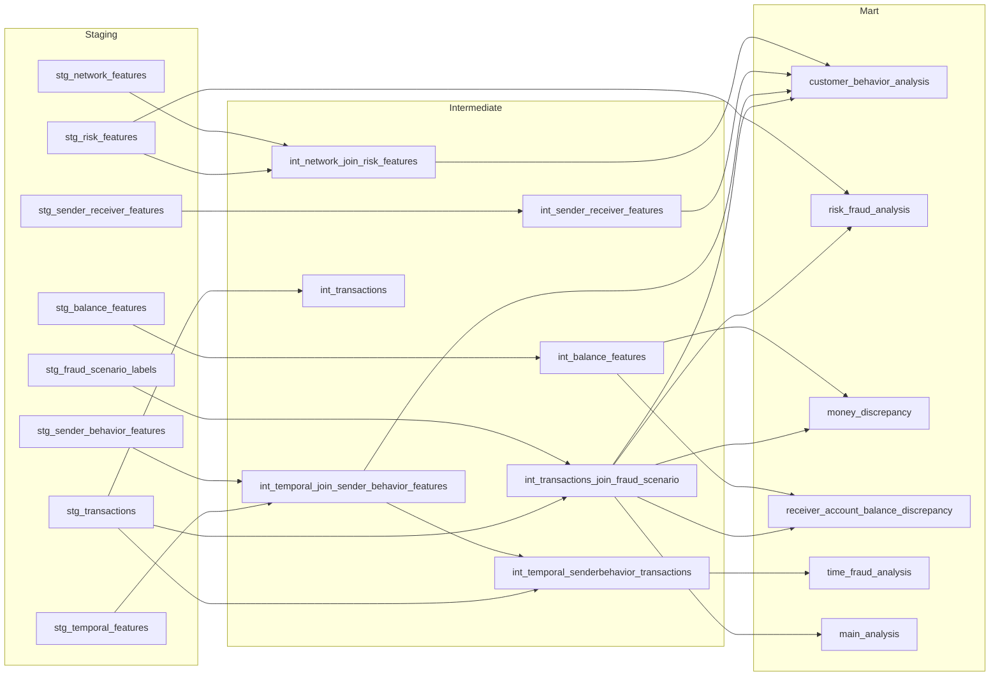

# 💳 Money Fraud: Mobil Para İşlemlerinde Dolandırıcılık Tespiti

BigQuery ve dbt ile katmanlı olarak hazırlanan veri modeli üzerinde, **6,3 milyon** mobil para işleminde dolandırıcılık (fraud) davranışlarını analiz eden, kural tabanlı risk skoru üreten ve LightGBM ile tahmin eden uçtan uca bir veri projesi.

> DATA426 – Group 3 dönem projesi. Üç kişilik ekip çalışmasıdır: dbt veri hattı ortak, hipotez testleri ve modeller bireyseldir (bkz. [Ekip ve Katkılar](#-ekip-ve-katkılar)). Bu repodaki notebook, ekip üyelerinden Ceren Kocabaş'ın çalışmasıdır.

## 🔗 Bağlantılar

| | |
|---|---|
| 📊 Dashboard (Looker Studio) | [Mobile Money Fraud Analysis](https://datastudio.google.com/reporting/bdade0b5-2c91-442a-9d5c-ce3a7aa240cb/page/uoH2F) |
| 🗄️ BigQuery çalışma alanı | [data426-group3 / money_fraud](https://console.cloud.google.com/bigquery?ws=!1m4!1m3!3m2!1sdata426-group3!2smoney_fraud) (erişim izni gerekir) |
| 📓 Notebook | [`Money_Fraud.ipynb`](Money_Fraud.ipynb) (Google Colab'de açılabilir) |

---

## 📌 Proje Özeti

1. **Veri mühendisliği (dbt):** 8 ham BigQuery tablosu `staging → intermediate → mart` katmanlarından geçirilerek temizlendi, birleştirildi ve analiz tablolarına dönüştürüldü.
2. **İstatistiksel analiz:** Fraud'un işlem türlerine göre dağılımı ve hesap boşaltma davranışı hipotez testleriyle incelendi.
3. **Risk skorlama:** İşlem bazlı kural tabanlı bir risk skoru ve risk segmentleri tanımlandı, gerçek performansı ölçüldü.
4. **Makine öğrenmesi:** İlk kurulum (Deney 1) çok fazla yanlış alarm üretti. Düzeltilmiş kurulum (Deney 2) basit bir kural baseline'ı ile karşılaştırıldı.
5. **Görselleştirme:** Sonuçlar Looker Studio dashboard'unda sunuldu.

## 🛠️ Kullanılan Teknolojiler

| Alan | Araç |
|---|---|
| Veri ambarı | Google BigQuery |
| Veri dönüşümü | dbt Cloud (Jinja + SQL) |
| Analiz ortamı | Google Colab, Python |
| Kütüphaneler | pandas, NumPy, SciPy, statsmodels, scikit-learn, LightGBM |
| Görselleştirme | Looker Studio |

## 📊 Veri Seti

Kullanılan veri, **PaySim** simülatörüyle üretilmiş **sentetik** mobil para işlemleridir (Kaggle: `ealaxi/paysim1`, orijinal veri setinin 1/4'ü). Kaggle'daki orijinal sayfaya şu anda erişilememektedir. Veri setinin atıf yapılacak kaynağı: *PaySim: A financial mobile money simulator for fraud detection* (E. A. Lopez-Rojas ve ark.).

- **Toplam işlem:** 6.362.620
- **Fraud işlem:** 8.213 (~%0,13, çok dengesiz)
- **İşlem türleri:** `CASH_IN`, `CASH_OUT`, `DEBIT`, `PAYMENT`, `TRANSFER`
- **Hedef değişken:** `is_fraud`

⚠️ **Önemli not:** Veri setinin yazarları, fraud tespitinde bakiye sütunlarının (`oldbalanceOrg`, `newbalanceOrig`, `oldbalanceDest`, `newbalanceDest`) kullanılmamasını önerir, çünkü fraud olarak tespit edilen işlemler iptal edilir. Bu projedeki en güçlü özellikler (`is_liquidation`, `transfer_drain_ratio`) bu sütunlardan türetilmiştir. Ayrıca simülatörde fraud, hesabın boşaltılması senaryosuyla üretilmiştir. Bu yüzden sonuçlar gerçek bankacılık verisine doğrudan taşınamaz.

## 🗂️ Proje Yapısı

```
money_fraud/
├── models/
│   ├── staging/         # Her ham tablo için bir stg_ modeli (tip dönüşümü, temizlik)
│   ├── intermediate/    # int_ modelleri: tablolar arası birleştirmeler
│   └── mart/            # Analiz ve model için nihai tablolar
├── analyses/
├── macros/
├── seeds/
├── snapshots/
├── tests/
├── dbt_project.yml
├── Money_Fraud.ipynb    # Hipotez testleri, risk skoru ve makine öğrenmesi
└── README.md
```

## 🔄 Veri Akışı (dbt Lineage)



### Staging katmanı

| Model | Ne yapar? |
|---|---|
| `stg_..__transactions` | Sütunları yeniden adlandırır, parasal alanları 2 basamağa yuvarlar, bayrakları `integer` yapar |
| `stg_..__fraud_scenario_labels` | Senaryo etiketlerini küçük harfe çevirir, eksikleri `unknown` / `0` ile doldurur |
| `stg_..__temporal_features` | `day` (1–31) ve `hour` (0–23) aralıklarını doğrular, gün dilimini normalize eder |
| `stg_..__sender_behavior_features` | Gönderen davranış sayaçlarında negatif değerleri 0'a çeker |
| `stg_..__sender_receiver_features` | Sayaçları `int64`, `is_new_receiver_for_sender` alanını `boolean` yapar |
| `stg_..__risk_features` | Kural tabanlı risk bayraklarını seçer |
| `stg_..__network_features` | Ağ (derece, alıcı hacmi) özelliklerini seçer |
| `stg_..__balance_features` | Bakiye farkı ve hata payı alanlarını hazırlar (`leakage_warning` dahil) |

### Intermediate katmanı

| Model | Ne yapar? |
|---|---|
| `int_..__transactions_join_fraud_scenario` | İşlemleri fraud senaryo etiketleriyle birleştirir |
| `int_..__temporal_join_sender_behavior_features` | Zamansal özellikler ile gönderen davranış özelliklerini birleştirir |
| `int_..__sender_receiver_features` | Gönderen–alıcı ilişki özellikleri |
| `int_..__network_join_risk_features` | Ağ özellikleri ile risk bayraklarını birleştirir |
| `int_..__balance_features` | Bakiye tutarsızlık özellikleri |
| `int_..__temporal_senderbehavior_transactions` | İşlemleri zamansal ve gönderen davranış özellikleriyle zenginleştirir |
| `int_..__transactions` | Staging'deki işlem tablosundan ilgili sütunları seçerek ara katmana taşır |

### Mart katmanı

Her ekip üyesi kendi mart tablolarını oluşturmuştur. Dosya adlarında `group3` sonrasında bazen tek, bazen çift alt çizgi vardır, aşağıda adlar olduğu gibi yazılmıştır.

| Model | Amaç |
|---|---|
| `mart_data426_group3_customer_behavior_analysis` | **Bu notebook'un kullandığı ana tablo.** Tüm özellikler, risk skoru ve segment burada üretilir (38 sütun) |
| `mart_data426_group3_risk_fraud_analysis` | Kural tabanlı risk skoru/seviyesi ile gerçek fraud etiketinin karşılaştırması |
| `mart_data426_group3_money_discrepancy` | Gönderen ve alıcı tarafındaki bakiye tutarsızlıkları |
| `mart_data426_group3__receiver_account_balance_discrepancy` | Müşteri alıcılarda bakiyesi beklenen tutarla uyuşmayan işlemler |
| `mart_data426_group3__time_fraud_analysis` | Saat ve gün dilimi bazında işlem sayısı, fraud oranı, ortalama/maksimum tutar ve ani yükselen işlem sayısı |
| `mart_data426_group3__main_analysis` | İşlem düzeyinde sade tablo: `type_code`, `amount_bucket`, senaryo kodları (`scenario_group_code`, `fraud_scenario_code`) |

### Ana mart tablosunda üretilen özellikler

| Özellik | Açıklama |
|---|---|
| `type_code` | İşlem türünün sayısal kodu (TRANSFER=1, CASH_OUT=2, CASH_IN=3, DEBIT=4, PAYMENT=5) |
| `amount_bucket` | Tutar aralığı (0, 0-100, 100-1K … 1M+) |
| `custom_month_id` | Her 30 günlük dönem için ay kimliği |
| `monthly_transfer_volume` | Göndericinin aylık toplam TRANSFER hacmi |
| `amount_to_monthly_volume_ratio` | İşlem tutarının aylık transfer hacmine oranı |
| `is_liquidation` | Hesabın tamamının boşaltılıp boşaltılmadığı (`amount = old_balance_orig > 0`) |
| `transfer_drain_ratio` | İşlem tutarının hesap bakiyesine oranı |
| `is_new_receiver_for_sender` | Gönderenin alıcıya ilk kez para göndermesi |
| `is_night` | Gece işlemi |
| `high_amount_flag`, `high_velocity_flag`, `new_receiver_flag`, `many_to_one_receiver_flag`, `suspicious_cashout_flag` | Risk bayrakları |
| `calculated_risk_score`, `risk_segment` | Toplam risk puanı ve segment |

## 🔬 Hipotez Analizleri

### 1. İşlem türü ile fraud ilişkisi (Ki-Kare Bağımsızlık Testi)

- χ² = **22.082,54**, serbestlik derecesi = 4, p ≈ 0 → fraud'un işlem türünden bağımsız olduğu hipotezi reddedildi.
- Tüm fraud vakaları iki türde toplanıyor: `CASH_OUT` (4.116) ve `TRANSFER` (4.097). `CASH_IN`, `DEBIT` ve `PAYMENT` işlemlerinde hiç fraud yok.
- Fraud oranı `TRANSFER`'de %0,77, `CASH_OUT`'ta %0,18'dir (genel oran %0,13).
- Örneklem 6,3 milyon olduğu için neredeyse her fark anlamlı çıkar. Etki büyüklüğü (Cramér's V ≈ 0,06) küçüktür.

### 2. Hesap boşaltma davranışı (İki Örneklem Oran Z-Testi)

| Grup | Hesabı tamamen boşaltma oranı |
|---|---|
| Fraud | **%98,12** (8.018 / 8.172) |
| Normal | **%0,00** (0 / 4.251.999) |

Z = 2044,44, p ≈ 0. `is_liquidation == 1` olan **tüm** işlemler fraud'tur (8.018 / 8.018), kalan 195 fraud kısmi çekim ya da sıfır bakiyeli hesaptır.

> Dashboard'daki Ki-Kare ve hesap boşaltma Z-testi bu notebook'taki testlerdir. Dashboard'daki diğer testler (gönderen/alıcı bakiyesi ve işlem tutarı için Mann-Whitney U, bayraklanan fraud ilişkisi) ekip arkadaşlarının kendi notebook'larında yapılmıştır.

## 🚦 Risk Skoru

Skor, tetiklenen kırmızı bayrakların puanlarının toplamıdır:

| Bayrak / Koşul | Puan |
|---|---|
| `is_liquidation = 1` (hesap tamamen boşaltıldı) | 20 |
| `transfer_drain_ratio >= 0.90` ve boşaltma yok | 15 |
| `suspicious_cashout_flag` | 20 |
| `many_to_one_receiver_flag` | 15 |
| `is_new_receiver_for_sender` | 10 |
| `new_receiver_flag` | 5 |
| `amount_to_monthly_volume_ratio > 1.0` | 15 |
| `high_amount_flag` | 10 |
| `high_velocity_flag` | 15 |
| `is_night` | 5 |
| İşlem türü `TRANSFER` veya `CASH_OUT` | 5 |

Teorik maksimum puan 120'dir. Veride en yüksek skor normal işlemlerde 75, fraud işlemlerinde 85'tir. `is_new_receiver_for_sender`, `new_receiver_flag` ve `high_velocity_flag` tüm satırlarda sabit olduğundan her işlem büyük olasılıkla 15 puanla başlar.

### Segment performansı

| Segment | İşlem | Fraud | Fraud oranı | Tüm fraud'un payı |
|---|---|---|---|---|
| Orta Risk (15–24) | 4.265.819 | 39 | %0,001 | %0,5 |
| Yüksek Risk (25–49) | 2.077.390 | 6.335 | %0,305 | %77,1 |
| Çok Yüksek Risk (≥50) | 19.411 | 1.839 | %9,47 | %22,4 |

- "Düşük Risk" segmenti boştur (minimum skor 15).
- **≥50 "kesin blokaj" için uygun değildir:** bu segmentteki 19.411 işlemin 17.572'si normal işlemdir.
- Skor ile fraud oranı doğrusal artmaz (skor 40'ta %64,7; skor 55'te %1,9; skor 75'te %94,8).
- Risk skoru, tek başına karar mekanizması olarak zayıftır. Ancak açıklanabilir bir ön filtre olarak değerlidir: skoru 15–24 olan işlemler verinin %67'sidir ve yalnızca %0,5 fraud içerir.

## 🤖 Makine Öğrenmesi

Tüm modeller aynı bölmeyle değerlendirilmiştir: %80 eğitim / %20 test (`random_state=42`, `stratify`). Test setinde 1.272.524 işlem ve 1.643 fraud vardır.

### Deney 1: İlk model (12 özellik, risk skoru dahil)

LightGBM, `is_unbalance=True`, 100 ağaç.

| Metrik | Değer |
|---|---|
| Recall | 0,995 (1.634 / 1.643) |
| Precision | 0,019 |
| Yanlış alarm | 82.399 |
| ROC-AUC | 0,966 |

Model fraud'un neredeyse tamamını yakalıyor ama her gerçek fraud'a yaklaşık 50 yanlış alarm üretiyor. Eşik değiştirmek sonucu değiştirmiyor (olasılıklar 0 ve 1'e yığılmış). Bu kurulum pratikte kullanılamaz.

### Deney 2: Kural baseline'ı + düzeltilmiş model

**Değişiklikler:**
- Tüm satırlarda aynı değeri taşıyan 3 bayrak ve `calculated_risk_score` çıkarıldı (8 özellik kaldı).
- `is_liquidation == 1` kuralı baseline olarak eklendi.
- Doğrulama setiyle erken durdurma, `scale_pos_weight=10`, `min_child_samples=50`, `reg_lambda=1` kullanıldı (170 ağaçta durdu).

| Yaklaşım | Precision | Recall | Yanlış alarm | Kaçan fraud |
|---|---|---|---|---|
| Yalnızca kural (`is_liquidation == 1`) | 1,000 | 0,977 | 0 | 38 |
| Kural + model (eşik 0,5) | 0,996 | 0,996 | 7 | 7 |
| Kural + model (eşik 0,9) | 0,998 | 0,991 | 4 | 14 |

- Modelin genel PR-AUC'si 0,996'dır.
- Deney 1'e göre yanlış alarm sayısı 82.399'dan 7'ye düştü.
- Kural dışı işlemlerde modelin PR-AUC'si 0,70'tir (rastgele tahmin ≈ 0,00003). Kuralın kaçırdığı 38 test fraud'undan model eşik 0,5'te 31'ini yakaladı.
- Model büyük ölçüde `is_liquidation` ve `transfer_drain_ratio` özelliklerine dayanıyor.
- Eşik 0,5 sonuçlara bakılmadan seçilen varsayılan değerdir, 0,9 yalnızca karşılaştırma içindir.

### Veri setinin kendi bayrağı ile karşılaştırma (tüm veri)

| Kural | Yakalanan fraud | Recall | Yanlış alarm |
|---|---|---|---|
| `is_flagged_fraud` (veri setinin kendi bayrağı) | 16 / 8.213 | %0,19 | 0 |
| `is_liquidation == 1` | 8.018 / 8.213 | %97,6 | 0 |

### Kuralın kaçırdığı fraud'lar

Tüm veride kuralın kaçırdığı 195 fraud'un 154'ü kısmi çekimdir (`TRANSFER`), 41'inin başlangıç bakiyesi 0'dır (`CASH_OUT`). Kısmi çekimlerin 145'i (%94) tam **10.000.000** tutarındadır ve 148'inde hesap bakiyesi 10 milyondan yüksektir. Fraud işlemlerinde en yüksek tutar tam 10 milyondur, normal işlemlerde ise 92 milyona kadar çıkar. Bu, fraud tutarlarının simülasyonda sınırlandırıldığını düşündürür. `amount == 10M` tek başına kural olarak kullanılamaz (2.920 normal işlem de tam 10M).

### Ek deney: risk skoru modele eklenirse?

| Model | Genel PR-AUC | Kural dışı PR-AUC |
|---|---|---|
| Skor yok (8 özellik) | 0,9957 | 0,6982 |
| Skor var (9 özellik) | 0,9957 | 0,7231 |

Genel PR-AUC aynıdır. Skor, diğer bayrakların puan toplamı olduğu için modele ek bilgi katmaz. Kural dışı gruptaki fark yalnızca 38 fraud'a dayandığı için gürültü düzeyindedir.

## 📈 Dashboard

Sonuçlar [Looker Studio dashboard'unda](https://datastudio.google.com/reporting/bdade0b5-2c91-442a-9d5c-ce3a7aa240cb/page/uoH2F) şu bölümlerle sunulmuştur: işlem tutarı analizi, zaman analizi, hesap boşaltma analizi, işlem türü analizi, gerçek fraud ve tutarsızlık analizi ve özet bulgular.

<!-- Görseller eklenecekse images/ klasörüne koyup şu satırları açın:


-->

> Dashboard'un son bölümündeki makine öğrenmesi modeli Ataberk Şahin'in çalışmasıdır, bu repodaki LightGBM modelinden farklıdır.

## ⚠️ Sınırlamalar

- **Sentetik veri:** Fraud, simülatörde "hesabı boşalt" senaryosuyla üretilmiştir. Bu yüzden `is_liquidation` kuralı çok güçlü çıkar. Sonuçlar gerçek bankacılık verisine doğrudan taşınamaz.
- **Bakiye sütunları:** Veri setinin yazarları bakiye sütunlarını fraud tespitinde önermez. En güçlü özellikler bu sütunlardan türetilmiştir.
- **Az örnek:** Kural dışı test grubunda yalnızca 38 fraud var. Eşik 0,5 ile 0,9 arasındaki fark (7 ve 4 yanlış alarm) bu örneklemle gürültü düzeyindedir. Sonuçlar tek bir bölmeye dayanıyor.
- **Tekrarlanabilirlik:** BigQuery satır sırasını garanti etmez. Bölme `random_state` ile sabit olsa da satır sırası değişirse test seti değişir. Notebook'ta Drive'a kaydedilen CSV'yi kullanmak sonuçları tekrarlanabilir kılar.
- **Skor kalibrasyonu:** Risk puanı ağırlıkları kalibre değildir, yüksek puan her zaman daha yüksek fraud oranı anlamına gelmez.

## 🚀 Kurulum ve Çalıştırma

```bash
# 1. Repoyu klonla
git clone https://github.com/Crnkcbs/money_fraud.git
cd money_fraud

# 2. dbt BigQuery adaptörünü kur
pip install dbt-bigquery

# 3. profiles.yml dosyasında BigQuery bağlantını tanımla
#    project: <gcp-proje-id>, dataset: <dataset-adı>

# 4. Modelleri çalıştır ve test et
dbt run
dbt test
```

Ardından `Money_Fraud.ipynb` dosyasını Google Colab'de açıp BigQuery kimlik doğrulamasıyla çalıştırabilirsin. Notebook, mart tablosunu BigQuery'den çekip Drive'a CSV olarak kaydeder.

## 🔭 Sonraki Adımlar

- Bakiye sütunları olmadan model karşılaştırması
- Farklı `random_state` değerleriyle sonuçların kararlılık testi
- dbt testlerinin ve dokümantasyonun (`dbt docs generate`) genişletilmesi
- Risk skoru ağırlıklarının veriden öğrenilmesi (ör. lojistik regresyon katsayılarıyla)

## 👥 Ekip ve Katkılar

Ekip üyeleri: Ataberk Şahin, Cansu Gamze Tadik, Ceren Kocabaş.

| Bölüm | Kim yaptı? |
|---|---|
| dbt veri hattı (staging → intermediate → mart tabloları) | Ortak çalışma (üç üye) |
| Hipotez testleri | Bireysel. Her üye kendi testlerini kendi notebook'unda yapmıştır |
| Makine öğrenmesi modeli | Bireysel. Her üye kendi modelini geliştirmiştir |
| Bu repodaki `Money_Fraud.ipynb` (Ki-Kare, hesap boşaltma Z-testi, risk skoru analizi, LightGBM deneyleri) | Ceren Kocabaş |
| Looker Studio dashboard'u | Ortak çalışma. Dashboard'un son bölümündeki model Ataberk Şahin'in modelidir |

Bu repoda yalnızca Ceren Kocabaş'ın notebook'u bulunur. Diğer üyelerin notebook'ları ve modelleri bu repoda yer almaz.

## 📄 Lisans

Bu proje MIT lisansı altındadır. Ayrıntılar için [LICENSE](LICENSE) dosyasına bakın.
